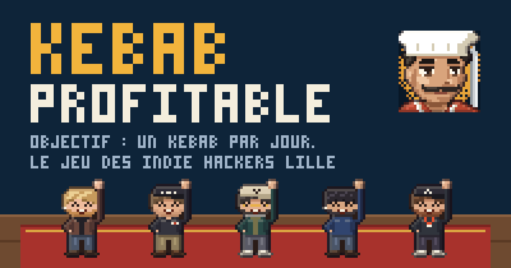
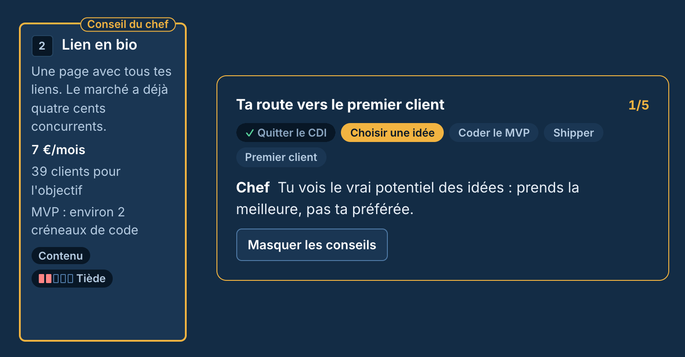
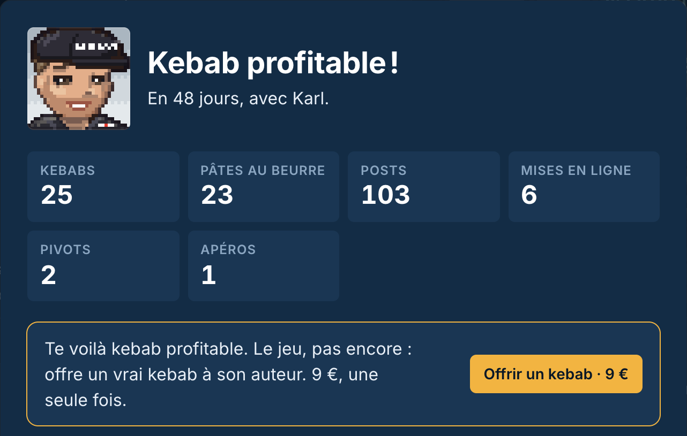
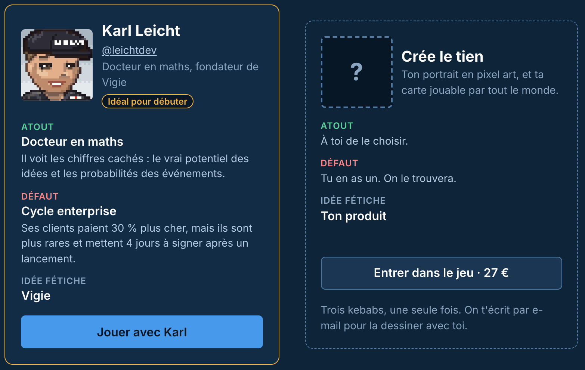
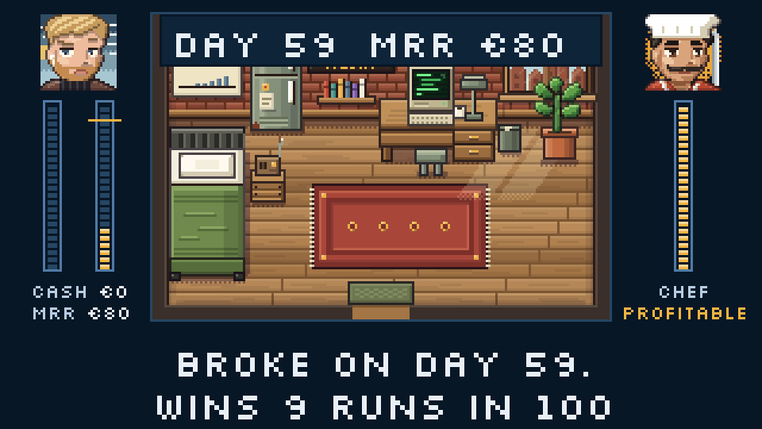

name: inverse
layout: true
class: center, middle, inverse

---

layout: false

<!-- 15 min. À couper en cas de retard, dans l'ordre : « Le son », « Under the hood », « Le film de lancement », « Ce qu'on ne fait pas ». -->

# How I shipped Kebab Profitable 🥙

## un jeu, en une semaine, avec l'IA

📍 Indie Hackers Lille · Apéro #50

🗓️ _8 décembre 2026_

<small class="text-hint">`C` pour cloner l'affichage ; `P` pour passer en mode présentateur.</small>

???
_00:00_

Levez la main : qui a déjà joué ? Qui est dans le leaderboard ?

---

class: center, middle

# 100 commits. 150 visiteurs.

--

# **0 €.**

???
_00:20_

Une semaine avec l'IA pour construire le jeu. Dix jours en ligne. Pas un euro.

Construire, c'est réglé. Vendre, non. Ce talk, ce sont les deux moitiés : comment je l'ai construit, et le plan pour qu'il rapporte d'ici le 8 janvier.

---

class: center, middle

.pixel-shot[]

_« Fais plus de thune que moi. Si tu peux. »_

???
_00:45_

Voici Chef. Il tient le kebab en bas de chez toi. Lui, il gagne de l'argent. Toi, non.

---

## Le pitch

Tu viens de signer ta _rupture conventionnelle_.

--

- 💶 1 500 € en banque, un studio à Lille, un kebab en bas

--

- 🎯 Un objectif : **270 € de MRR**, le prix d'un kebab par jour

--

- 💀 Plus de cash : _retour au CDI_

--

<br>

👉 [kebab-profitable.vercel.app](https://kebab-profitable.vercel.app)

???
Un jeu de gestion parodique sur l'indie hacking, fait pour ce groupe. Certains d'entre vous sont dedans.

---

class: center, middle



???
_01:30_

Trois créneaux par jour : matin, après-midi, soir. Coder, shipper, poster, cold outreach, freelance, se reposer, pivoter, et l'apéro mensuel au Charlatan.

---

## Ce qu'il y a dedans

--

- 🧠 Un rules engine en TypeScript pur, et un **simulateur d'équilibrage** (`pnpm sim`)

--

- 🎲 Un **daily run seedé** : tout le monde a la même chance, on compare les décisions

--

- 🏆 Un leaderboard hebdo qui **rejoue chaque partie sur le serveur**. Pas de triche.

--

- 🎨 Du pixel art et 🎵 de la musique **écrits en code**

--

- 🥙 Chef : un coach avec une centaine de répliques, distribuées comme un paquet de cartes mélangé

--

- ⏱️ Des cartes urgentes : 6 secondes pour décider. La prod est down.

???
Rien de ce que le navigateur annonce n'est classé. Le serveur rejoue ta liste de coups avec le même engine.

---

template: inverse

# Les chiffres

---

## Une semaine, puis le polish

```console
premier commit  : sam. 15 nov. 2026
dernier commit  : mer. 26 nov. 2026
jours de commit : 10 sur 12
commits         : 100 (dont 91 la première semaine)
lignes ajoutées : 35 628
lignes retirées : 6 658
```

--

**96 commits sur 100** co-écrits avec Claude.

???
_03:00_

Dès le premier jour, il y avait l'engine, la sim, l'UI, l'API du leaderboard. Puis six jours de polish : 91 commits la première semaine. Depuis le lancement, des événements URSSAF et l'apéro. Le jeu, il est dans le polish.

---

## L'usage de l'IA, d'après les logs de session

|                         |                                           |
| ----------------------- | ----------------------------------------- |
| Sessions                | **25**                                    |
| Prompts tapés           | **122** (dont 43 skills en slash command) |
| Tours du modèle         | **2 121**                                 |
| Tool calls              | **2 565** (dont 1 482 commandes shell)    |
| Recherches web          | **120**                                   |
| Subagents lancés        | **13**                                    |
| Output tokens           | **2,7 M**                                 |
| Contexte lu en cache    | **575 M** de tokens                       |
| Coût, au tarif de l'API | **≈ 351 $** (Fable 282 $, Opus 69 $)      |

<small class="text-hint">Logs Claude Code du 15 au 26 novembre 2026. Coût recalculé au tarif public de l'API, cache compris.</small>

???
122 prompts pour 100 commits. À peu près un prompt par commit. J'ai écrit des intentions, pas du code.

575 M de tokens en cache : le modèle relit tout le projet à chaque tour. C'est le prompt caching qui rend ça abordable : ces lectures ont coûté 115 $, sans cache elles en auraient coûté environ 4 000.

351 $ au tarif API : une quarantaine de kebabs. Le jeu doit en vendre 30 pour être kebab profitable.

---

## Quel modèle a fait quoi

--

- 🦄 **Claude Fable 5.2** — 63 % des tours, 60 commits

  le jeu lui-même : engine, art, son, UI

--

- 🧠 **Claude Opus 5.5** — 36 % des tours, 36 commits

  film de lancement, SEO, prépa Product Hunt, le layout mobile, les événements URSSAF

--

- ⚡ **Claude Haiku 5.5** — 1 %, les petites corvées

???
Règle de base : le modèle le plus capable pour le travail créatif où le goût compte, le plus rapide pour les tâches bien spécifiées.

---

template: inverse

# Les outils

---

class: scene

## La stack

LE JEU DANS LE NAVIGATEUR · LE SERVEUR REJOUE · LE MARKETPLACE BRANCHE LE RESTE

<object data="./images/kebab-profitable/scene-stack.svg" type="image/svg+xml" data-play-on-show aria-label="La stack : Next.js 16, Vercel, Upstash Redis, Stripe, Vercel Analytics, Vitest"></object>

???
`vercel integration add upstash/upstash-kv` et `vercel integration add stripe`. Aucun clic dans un dashboard, c'est l'agent qui l'a fait.

Pas de base de données sur les preview deployments, exprès : une partie de test n'atteint jamais le vrai classement.

---

class: scene

## L'atelier

T3 CODE PILOTE · CLAUDE CODE CONSTRUIT · GIT GARDE LA TRACE

<object data="./images/kebab-profitable/scene-workshop.svg" type="image/svg+xml" data-play-on-show aria-label="L'atelier : T3 Code lance un agent Claude Code par thread, chacun dans son worktree, avec le shell, la preview et les skills, jusqu'à git et Vercel"></object>

???
J'écris une intention dans un thread T3 Code. Chaque thread lance son propre agent Claude Code, dans son propre worktree : Fable sur le jeu, Opus sur le film, Haiku sur les corvées. Ils avancent en parallèle sans se marcher dessus.

L'agent ne fait pas qu'écrire du code. Il ouvre le jeu dans la preview, y joue, regarde l'écran et corrige ce qui cloche. C'est la boucle au centre.

Le film de lancement de 48 secondes, c'est Chrome headless + ffmpeg, rendu image par image par le même agent.
---

## Les skills : apprendre un métier à l'agent

--

- 🎨 **pxl** — le pixel art en code (MIT, `crsolver/claude-pxl`)

--

- 🎵 **chirp** — un synthé, la musique en code (MIT, `uilianks/chirp`)

--

- ✍️ **better-\*** : écriture, layout, typo, couleurs, accessibilité ([jakub.kr/skills](https://jakub.kr/skills))

--

- 🔥 **grilling** — l'agent cuisine mon plan avant de le construire ([aihero.dev/skills-grill-me](https://www.aihero.dev/skills-grill-me))

--

- 🛒 **vercel:marketplace** — provisionner Redis et Stripe comme il faut

???
Un skill, c'est un dossier d'instructions et de scripts que l'agent charge quand il en a besoin. pxl et chirp vivent dans le repo, dans `.claude/skills/`.

---

class: center, middle

.pixel-shot[]

`art/kebab.px.js` → `pnpm art` → PNG

???
_07:30_

Chaque pixel ici est du code. Les conventions Neo Geo : des dégradés qui changent de teinte, des contours de la couleur de ce qu'ils entourent, une seule lumière en haut à gauche. J'ai donné les conventions à l'agent, le skill les applique.

---

## Le son

```javascript
// audio/kebab.cx.js — un seul fichier, chaque effet et chaque musique
// un coffre s'ouvre quand un client s'inscrit
// quatre mesures de fanfare quand tu gagnes, les mêmes notes qui tombent quand tu perds
```

--

- Trois boucles musicales dans des tonalités voisines, pour enchaîner de l'une à l'autre

--

- Des boucles sans couture, dans tous les navigateurs

???
À couper si besoin. Le son du coffre quand tu signes un client, c'est la meilleure dopamine du jeu.

---

## Under the hood : l'équilibrage par la simulation

```console
$ pnpm sim
```

--

- Des joueurs scriptés enchaînent des milliers de parties

--

- Un bon joueur est kebab profitable en **~45 jours, ~200 clics**, soit **~10 minutes** de jeu

--

- Les conseils de Chef sont **testés** : un débutant qui les suit gagne bien plus souvent ([skill onboarding](https://marketing-skills.com/skills/onboarding))



???
À couper si besoin. C'est la partie qu'un humain ne ferait jamais à la main. L'agent ajuste un chiffre dans `balance.ts`, relance la sim, lit les taux de victoire.

La capture : le premier jour d'une première partie. Chef marque son conseil sur une idée et montre la route vers le premier client, en cinq étapes. Ces conseils sont vérifiés par `src/ui/coach.test.ts`.

L'histoire derrière : j'ai fait tester le jeu à ma femme, et elle n'a pas compris comment ça fonctionnait. Je n'ai rien conçu moi-même : j'ai juste lancé le skill onboarding de marketing-skills.com pour améliorer l'onboarding. C'est de là que vient la route vers le premier client, avec un conseil de Chef à chaque étape.

---

## Ce que j'ai vraiment fait

--

- 🎯 Décider de quoi parle le jeu

--

- 👀 Y jouer. Beaucoup. Dire ce qui sonne faux.

--

- ✂️ Dire non : « Ouvre le jeu en français pour tout le monde » → **revert** 2 minutes plus tard

???
_10:00_

Le boulot est passé de taper à avoir du goût. Chaque message de commit se lit comme une décision produit : « Le fondateur tourne sur lui-même et lève le poing pour un nouveau client. »

---

template: inverse

# Go-to-market

### 270 € en un mois. Zéro budget. Un dev.

---

## L'objectif : 270 € en un mois

Le jeu doit devenir kebab profitable. Lui aussi.

--

.pull-left[

### 30

kebabs à **9 €**, offerts à l'auteur à la fin d'une partie


]

--

.pull-right[

### 10

Founder cards à **27 €**. Trois kebabs la carte.


]

???
_11:00_

L'objectif du jeu, appliqué au jeu.

À gauche : l'écran de victoire, le seul endroit où l'offre kebab apparaît. À droite : une vraie carte de fondateur, et la case « Crée le tien » qui la vend.

---

## Où on en est

|                                                  |          |
| ------------------------------------------------ | -------- |
| Visiteurs en dix jours, à peu près               | **150**  |
| Viennent de France                               | **72 %** |
| Arrivés par X, le seul canal qui envoie du monde | **59**   |
| Encaissé : ni kebab, ni carte                    | **0 €**  |

Au moins **7 joueurs** ont gagné une partie.

<small class="text-hint">Source : Vercel Analytics, du 17 au 26 novembre 2026. Leaderboard du jeu au 26 novembre.</small>

???
<!-- TODO : mettre ces chiffres à jour le matin du talk. -->

---

## Le kebab ne suffira pas

L'offre à 9 € ne s'affiche qu'**après une victoire**.

--

- 🏆 **5 %** des visiteurs ont gagné une partie, donc vu l'offre

--

- 🥙 **1 sur 200** : un visiteur sur 200 achète un kebab, si un gagnant sur dix paie. C'est généreux pour un pourboire.

--

- 📉 **6 000** visiteurs pour vendre 30 kebabs. On en a eu 150.

<small class="text-hint">Estimation : il n'y a encore aucune vente à mesurer.</small>

???
Les maths tuent le pourboire. Le plan repose donc sur trois paris.

---

class: center, middle

### Pari 1

# L'argent est dans la Founder card

## 10 × 27 € = 270 €

Dix places à la table. Trois kebabs la place.

--

🎨 Ton portrait en pixel art · 🃏 Ta carte, jouable par tout le monde · 💡 Ton produit en idée fétiche · 📣 Ton @ sur la carte

???
Chaque acheteur devient un personnage, et partage le jeu pour le montrer. La carte vend autant de reach qu'une place.

---

## Pari 2 — les gens du jeu font le reach

.pull-left[

### 5

membres jouables

### 13

caméos, avec leur @
]

.pull-right[

**Jeudi 10 : un thread.**

- Un post par caméo : sa carte en image, son conseil « Dans la vraie vie », son @. Un seul @ par post.

- Le dernier post donne le lien.

- Le même matin, chaque membre poste sa carte.
  ]

???
Une carte te déplaît ? Elle sort du jeu le jour même.

---

## Pari 3 — la salle d'abord, Product Hunt ensuite

--

- 🍻 **Mar. 8 — l'apéro.** Le leaderboard à l'écran. Les premières ventes. Vos phrases, mot pour mot. La photo.

--

- 🔧 **Mer. 9 — on corrige.** Ce que la salle a trouvé. La photo et les chiffres vont dans le premier commentaire.

--

- 🚀 **Jeu. 10, 09:01 — Product Hunt.** Avec un leaderboard plein, des ventes et vos mots. Pas avec un tableau vide.

???
Le leaderboard repart à zéro chaque lundi. Jeudi, il est encore plein.

---

## Le film de lancement

.row[
.left-column[

]
.right-column[

]
]

- 🎬 48 secondes : la même partie, jouée deux fois. Ne poste jamais → à sec au jour 59. Poste → profitable au jour 43.

- 📐 Formats 16:9, 9:16 et 1:1, plus une version reduced motion

???
À couper si besoin. Chaque chiffre du film sort du vrai rules engine. Le message du film, c'est celui du jeu : distribution beats code.

---

## Le calendrier

| Quand                   | Quoi                                                                                                  |
| ----------------------- | ----------------------------------------------------------------------------------------------------- |
| Jusqu'au 6 déc.         | Rendre le funnel lisible. Le compteur de places. L'offre kebab après une défaite. Préparer le thread. |
| Lun. 7 déc.             | Message Luma aux inscrits : joue la partie du 8 avant de venir.                                       |
| **Mar. 8 déc., 19:00**  | **Cette salle. Dix places en vente.**                                                                 |
| Mer. 9 déc.             | Corriger. Presse locale, avec la photo.                                                               |
| **Jeu. 10 déc., 09:01** | **Product Hunt. Le thread des caméos. Les membres postent leur carte. LinkedIn.**                     |
| Lun. 14 déc.            | Premier podium de la semaine. Première nouvelle carte.                                                |
| Mar. 15 déc.            | Show HN.                                                                                              |
| Ven. 8 janv.            | On compte, et on publie le résultat, quel qu'il soit.                                                 |

---

## Ce qu'on ne fait pas

.pull-left[

- 💸 **Ads** — aucune marge pour acheter un visiteur

- 🔎 **SEO** — des mois à rentabiliser, personne ne cherche ce jeu

- 📬 **Newsletter, Discord** — de la machinerie pour un produit dont on a besoin chaque semaine
  ]

.pull-right[

- 📱 **TikTok, Insta** — la scène est sur X et LinkedIn

- 🛍️ **Autre chose à vendre** — pas avant la première vente

- 🇬🇧 **Un push en anglais** — l'anglais sert à Product Hunt, l'effort va au français
  ]

???
À couper si besoin. Dire non, ça fait aussi partie du plan.

---

## Comment on saura

### 0 / 270 €

Un seul chiffre : les euros encaissés.

--

- 🪑 **Aucune place vendue ce soir** → c'est l'offre qui cloche, pas le reach. On change le pitch avant jeudi.

--

- 🚪 **Des visiteurs, peu de parties lancées** → c'est l'écran titre. On arrête d'envoyer du monde et on corrige.

--

- ⏳ **Des parties lancées, peu de finies** → la partie est trop longue. On regarde où les gens s'arrêtent.

---

## Take-aways

--

- 🧠 L'IA a transformé une idée de week-end en **91 commits en une semaine**

--

- 🎯 Ton job, c'est **le goût et savoir dire non**, pas taper

--

- 🛠️ Donne à l'agent **des skills et un moyen de voir** ce qu'il a construit

--

- 📣 Conçois la distribution **dans** le produit, dès le premier jour

---

## À toi de jouer

--

1. 🎮 **Joue la partie du jour** — [kebab-profitable.vercel.app](https://kebab-profitable.vercel.app)

--

2. 🚀 **Jeudi, à 09:01** — donne ton nombre de jours sur Product Hunt

--

3. 🪑 **Prends une place** — 27 €. Dix places à la table.

???
_14:30_

Joue la partie du jour. Bats mon score. Et si tu gagnes, Chef aimerait bien son kebab.

---

class: outro

<object data="./images/kebab-profitable/scene-thanks.svg" type="image/svg+xml" data-play-on-show aria-label="Merci · David Leuliette · @flexbox_"></object>

???
_15:00_

Moi, c'est David, `@flexbox_` sur internet. Développeur React Native freelance depuis 2016, solopreneur derrière weshipit.today.

Le podcast : Le Cross Platform Show.

Les slides et les chiffres : davidl.fr/courses/kebab-profitable.html

Merci. Des questions ?
