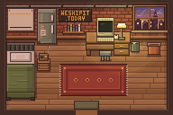
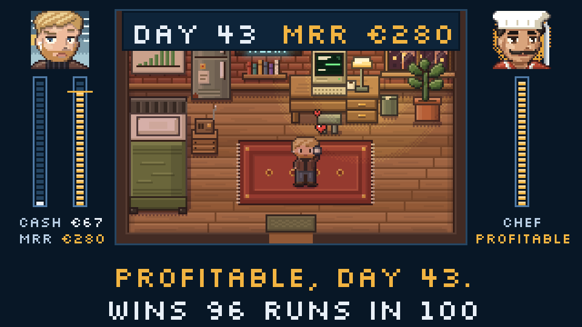

name: inverse
layout: true
class: center, middle, inverse

---

layout: false

<!-- 15 min. Cut candidates if running late, in order: "The sound", "Under the hood". -->
<!-- TODO: fill the traction slide (players, leaderboard, kebabs sold) the morning of the talk. -->

# How I shipped Kebab Profitable 🥙

## a game, in one week, with AI

📍 Indie Hackers Lille

🗓️ _November 2026_

<small class="text-hint">`C` to clone a display; `P` to switch to presenter mode.</small>

???
_00:00_

Show of hands: who played it already? Who is on the leaderboard?

15 minutes: what I built, how, with which tools, what it cost in AI, and what comes next.

---

## `/whois`

.remark-avatar[]

- Freelance React Native developer since 2016

- Solopreneur behind [weshipit.today](https://weshipit.today)

- [`@flexbox_` on X](https://x.com/flexbox_)

---

class: center, middle

.pixel-shot[]

???
_00:45_

Meet Chef. He owns the kebab shop downstairs. He makes money. You don't.

---

## The pitch

You just signed your _rupture conventionnelle_.

--

- 💶 €1,500 in the bank, a studio in Lille, a kebab shop downstairs

--

- 🎯 One goal: **€270 of MRR**, the price of a kebab a day

--

- 💀 Run out of cash: _retour au CDI_

--

<br>

👉 [kebab-profitable.vercel.app](https://kebab-profitable.vercel.app)

???
A parody management game about indie hacking, made for this group. Some of you are in it.

---

class: center, middle


???
_01:30_

Three slots a day: matin, après-midi, soir. Code, ship, post, cold outreach, freelance, rest, pivot, and the monthly apéro at Le Charlatan.

---

## What is inside

--

- 🧠 A pure TypeScript rules engine, and a **balance simulator** (`pnpm sim`)

--

- 🎲 A **seeded daily run**: everyone gets the same luck, so you compare decisions

--

- 🏆 A weekly leaderboard that **replays every run on the server**. No cheating.

--

- 🎨 Pixel art and 🎵 music **written as code**

--

- 🥙 Chef: a coach with a hundred lines, dealt like a shuffled deck

--

- ⏱️ Urgent cards: 6 seconds to decide. Production is down.

???
Nothing the browser claims is ranked. The server replays your list of moves with the same engine.

---

template: inverse

# The numbers

---

## One week

```console
first commit   : Sat 15 Nov 2026
last commit    : Sat 22 Nov 2026
commit days    : 7 of 8
commits        : 91
lines added    : 34,163
lines removed  : 6,203
```

--

**88 of 91 commits** co-authored by Claude.

???
_03:00_

The first day already had the engine, the sim, the UI, the leaderboard API. Then six days of polish. The polish is where the game is.

---

## AI usage, from the session logs

|                        |                                  |
| ---------------------- | -------------------------------- |
| Sessions               | **18**                           |
| Prompts I typed        | **155**                          |
| Model turns            | **1,868**                        |
| Tool calls             | **2,249** (1,287 shell commands) |
| Web searches + fetches | **113**                          |
| Subagents spawned      | **9**                            |
| Output tokens          | **2.5 M**                        |
| Cached context read    | **533 M** tokens                 |

???
155 prompts for 91 commits. That's less than two prompts per commit. I wrote intentions, not code.

533 M cached tokens: the model rereads the whole project on every turn. Prompt caching is what makes this affordable.

---

## Which model did what

--

- 🦄 **Claude Fable 5.2** — 70% of turns, 60 commits

  the game itself: engine, art, sound, UI

--

- 🧠 **Claude Opus 5.5** — 29% of turns, 28 commits

  launch film, SEO, Product Hunt prep, the phone layout

--

- ⚡ **Claude Haiku 5.5** — 1%, the small chores

???
Rule of thumb: the most capable model for creative work where taste matters, the faster one for well-specified tasks.

---

template: inverse

# The tools

---

## The stack

--

- ▲ **Next.js 16** on **Vercel**

--

- 🗄️ **Upstash Redis** for the leaderboard, one command from the Vercel Marketplace

--

- 💳 **Stripe Payment Links**, also from the Marketplace, made by a script

--

- 📈 **Vercel Analytics**, one line

--

- 🧪 **Vitest** + a balance simulator of scripted players

???
`vercel integration add upstash/upstash-kv` and `vercel integration add stripe`. No dashboard clicking, the agent did it.

No database in preview deployments, on purpose: a test run never reaches the real board.

---

## The workshop

--

- 🤖 **Claude Code**, driven from **T3 Code**: threads, worktrees, delegates

--

- 📱 **Argent**: the agent plays the game in a real browser, taps, screenshots, reads state

--

- 🔍 Built-in **preview**: resize to phone width, check the layout

--

- 🎬 **Headless Chrome + ffmpeg**: a 48-second launch film rendered frame by frame

???
The agent doesn't just write code. It opens the game, plays it, looks at the screen, and fixes what's wrong. 148 JavaScript evaluations in the running game, 53 screenshots.

---

## Skills: teach the agent a craft

--

- 🎨 **pxl** — pixel art as code (MIT, `crsolver/claude-pxl`)

--

- 🎵 **chirp** — a synthesiser, music as code (MIT, `uilianks/chirp`)

--

- ✍️ **better-\***: writing, layout, typography, colors, accessibility

--

- 🔥 **grilling** — the agent interrogates my plan before building it

--

- 🛒 **vercel:marketplace** — provision Redis and Stripe the right way

???
A skill is a folder of instructions and scripts the agent loads when it needs it. pxl and chirp live in the repo, in `.claude/skills/`.

---

class: center, middle

.pixel-shot[]

`art/kebab.px.js` → `pnpm art` → PNG

???
_07:30_

Every pixel here is code. Neo Geo conventions: ramps that shift hue, outlines the colour of what they surround, one light from the top left. I told the agent the conventions, the skill applies them.

---

## The sound

```javascript
// audio/kebab.cx.js — one file, every effect and every tune
// a chest opens when a customer signs up
// four bars of fanfare when you win, the same notes falling when you lose
```

--

- Three music loops in related keys, so one can follow another

--

- Loops without a seam in every browser

???
Cut candidate. The chest sound when you sign a customer is the best dopamine in the game.

---

## Under the hood: balance by simulation

```console
$ pnpm sim
```

--

- Scripted players run thousands of games

--

- A good player is kebab profitable in **~45 days, ~200 clicks**

--

- Chef's tips are **tested**: a newcomer who follows them wins far more often

???
Cut candidate. This is the part a human would never do by hand. The agent tunes a number in `balance.ts`, reruns the sim, reads the win rates.

---

## What I actually did

--

- 🎯 Decide what the game is about

--

- 👀 Play it. A lot. Say what feels wrong.

--

- ✂️ Say no: "Open the game in French for everyone" → **reverted** 2 minutes later

--

- 🧑‍🤝‍🧑 Ask the people in the game if they were OK being in it

???
_10:00_

The job moved from typing to taste. Every commit message reads like a product decision: "Have the founder spin and raise a fist for a new customer."

---

template: inverse

# Go-to-market

---

## Phase 0 — done: the room

--

- 🍻 Built **for one group**: this one. The apéro is in the game, linked to the real Luma.

--

- 🧑‍🎤 **You are in it**: members are playable founders, guests drop by at night

--

- 📣 Every month-end report has a **share on X** button that thanks the guests you met, by handle

--

- 🖼️ A win shares a **picture of that score**, read from the leaderboard

???
_11:00_

Distribution is designed into the game: when you share, you tag the people in it, and their followers see it.

---

## Traction so far

<!-- TODO: fill on the day -->

|                           |          |
| ------------------------- | -------- |
| Players                   | **TODO** |
| Winning runs on the board | **TODO** |
| Shares on X               | **TODO** |
| Kebabs bought (€9)        | **TODO** |
| Founder cards sold (€27)  | **TODO** |

---

## Phase 1 — Product Hunt

.row[
.left-column[

]
.right-column[

]
]

- 🎬 A 48-second film: the same run, played twice. Never posts → broke on day 59. Posts → profitable on day 43.

- 📐 16:9, 9:16 and 1:1 cuts, plus a reduced-motion version

???
Every number in the film comes from the real rules engine. The film's message is the game's message: distribution beats code.

---

## Phase 2 — make it pay for itself

--

- 🥙 **€9**: buy the author a real kebab after a win

--

- 🃏 **€27**: your own founder card, pixel portrait, playable, balanced with you by e-mail

--

- 🎯 Goal for the game itself: be **kebab profitable**. €270 a month.

???
The founder card is the clever one: every buyer becomes a character, and shares the game to show it off.

---

## Phase 3 — next rooms

--

- 🗺️ Other Indie Hackers chapters: their bar, their apéro, their founders

--

- 🃏 Open source cards: add an event, an idea, a guest with a pull request

--

- 🏢 The same recipe as a service: a small game for your community or your launch

???
_14:00_

The cards are plain data. `pnpm test` and `pnpm sim` check that a new card doesn't break the balance. Send me a PR.

---

## Take-aways

--

- 🧠 AI turned a weekend idea into **91 commits in a week**

--

- 🎯 Your job is **taste and saying no**, not typing

--

- 🛠️ Give the agent **skills and a way to see** what it built

--

- 📣 Design distribution **into** the product, from day one

---

template: inverse

# Merci 🥙

👉 [kebab-profitable.vercel.app](https://kebab-profitable.vercel.app)

[`@flexbox_`](https://x.com/flexbox_) · [weshipit.today](https://weshipit.today)

???
_15:00_

Play today's run. Beat my score. And if you win, Chef would like his kebab.
